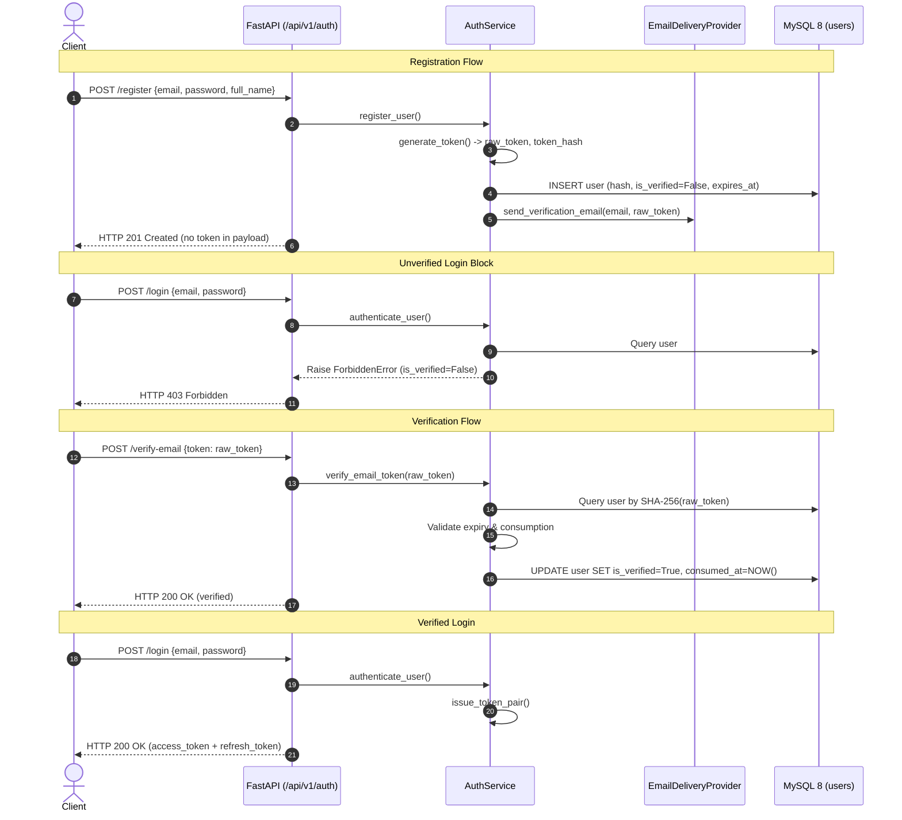

# Architectural Design: Secure Email Verification Lifecycle

## 1. Context & Architecture Overview

Revora's authentication foundation implements JWT issuance and refresh-token rotation in MySQL 8. However, account self-registration leaves accounts in an unverified state without an operational verification mechanism. This design introduces secure token verification, login gating, and delivery abstractions within the modular monolith architecture without introducing external messaging brokers or Redis.

## 2. Database Schema Evolution

Modify `users` table via Alembic migration adding:
- `verification_token_hash`: `VARCHAR(64) NULL INDEX` (SHA-256 hex digest)
- `verification_token_expires_at`: `DATETIME NULL` (Time-to-live expiration)
- `verification_token_consumed_at`: `DATETIME NULL` (Single-use replay guard)
- `last_verification_sent_at`: `DATETIME NULL` (Cooldown timestamp for resend)
- `resend_count`: `INT NOT NULL DEFAULT 0` (Resend attempt tracking)

Existing users remain intact: pre-existing rows have `is_verified = True` or `verification_token_hash = NULL`, ensuring zero breaking disruption.

## 3. Rate Limiting Architecture Without Redis

To avoid adding Redis for a single cooldown check, resend rate limiting is implemented directly using MySQL timestamps:
- Cooldown duration: **60 seconds**.
- Condition: If `last_verification_sent_at` is set and `(NOW() - last_verification_sent_at) < 60 seconds`, raise `RateLimitError` (`HTTP 429 Too Many Requests`, `code: "RATE_LIMIT_EXCEEDED"`).
- Daily ceiling: Maximum 5 resends per user account within 24 hours.

## 4. Replaceable Email Delivery Architecture

Defined in `src/domains/auth/email_delivery.py`:
- `EmailDeliveryProvider` (ABC):
  - `send_verification_email(to_email: str, recipient_name: str, raw_token: str) -> bool`
- `UnconfiguredEmailProvider`:
  - Production default until SES/SMTP is configured. Logs an info audit message without leaking the raw token.
- `DevInMemoryEmailSink`:
  - Test harness storing outbound emails in memory (`sink.get_latest_token(email)`). Used by automated pytest fixtures and local integration scripts.

## 5. Security & Privacy Guarantees
- Raw tokens are never stored in MySQL.
- Raw tokens are never logged by `logger`.
- Raw tokens are never returned in JSON response bodies (`RegisterResponse`, `ResendVerificationResponse`).
- Plaintext password and token hashing rely on `bcrypt` and `hashlib.sha256`.
